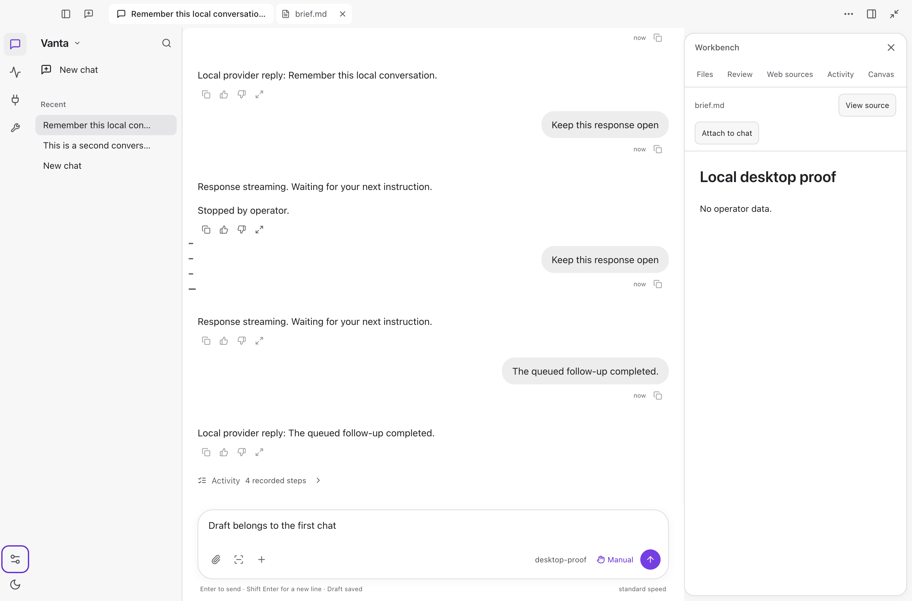

# Vanta

[](https://github.com/jpoindexter/Vanta/releases/latest) [](LICENSE) [](https://docs.vanta.theft.studio) [](CONTRIBUTING.md)

**Broad capability. Trusted continuity. Verified follow-through.**

Vanta is an open-source, full-capability personal AI operator for work and life that cross tools, files, research, software, documents, communication, schedules, business, media, and automation. Its wedge is trusted continuity: give it something real, and Vanta is designed to preserve the outcome, prepare or perform the next safe action, carry waiting and follow-up through interruption, and close only with evidence.

Vanta belongs in the broad personal-agent capability class. It specializes in reducing the executive burden required to turn intent into a verified outcome. Neurodivergent and disability experience supplies curb-cut universal-design requirements—concrete representation, low-friction capture, one recommendation, transition support, re-entry, and accessible operation—without limiting the audience or requiring diagnosis disclosure.

The destination is progressively earned practical autonomy. Workflows move from
R0 Observe → R1 Recommend → R2 Prepare → R3 Confirm → R4 Delegate → R5
Autonomous delegate through visible, revocable, user-owned grants. `R0`–`R5`
are autonomy labels only. There is no opaque self-expanding Full Access switch.

The canonical labels are **R0 — Observe**, **R1 — Recommend**,
**R2 — Prepare**, **R3 — Confirm**, **R4 — Delegate**, and
**R5 — Autonomous delegate**. The exact ordered WorkItem lifecycle is `draft`,
`queued`, `running`, `waiting`, `needs human`, `stopped`, `failed`,
`unverified`, `verified`. `denied`, `expired`, `unknown`, and `compensated`
are receipt/action dispositions, not WorkItem states.

> **Implementation truth (2026-08-17):** the bounded `TRUST-02`, `UX-03`, `TRUST-04`, `TRUST-01`, and `OP-01` contracts have executed receipts and are marked shipped for their documented local and signed macOS boundaries. The current draft stack also repairs tool-result adjacency, visible paste/queue interaction, and model controls, but it is still review work—not the public release. Cross-platform packaging, live external accounts, external proof, and future effect paths require their own evidence. See the [current acceptance record](docs/product-acceptance.md) and [final local consolidation audit](docs/final-consolidation-audit-2026-08-17.md).

<p align="center">
  
</p>

*October 3 development candidate, using disposable test data. This is not the
older public-release interface or a claim of completed ambient-agent behavior.*

## Start here

- **[Download Vanta Desktop for macOS](https://github.com/jpoindexter/Vanta/releases/download/v0.9.5/Vanta-0.9.5-arm64.dmg)** — signed, notarized, and stapled for Apple Silicon.
- **[Read the latest release notes](https://github.com/jpoindexter/Vanta/releases/tag/v0.9.8)** — reusable runs, safe replay, Buzz ACP, integrations, and reliability fixes. The v0.9.5 download above remains the latest notarized Desktop DMG.
- **[Read the docs](https://docs.vanta.theft.studio/)** — setup, safety model, agents, memory, MCP, messaging, and the live roadmap.
- **[Follow the roadmap](ROADMAP.md)** — canonical status lives in `roadmap.json`; generated views and local implementation evidence have separate publication boundaries. Paid growth and unfamiliar-person testing remain deferred. No paid participants, recruiting, research platforms, Actions, hosting, outreach, or new service spend are authorized.

## Ambient Desktop redesign — local candidate, not a release

**Current execution priority — October 28:** agent usefulness for business
research, GTM preparation and explicitly approved outreach comes before broader
voice expansion or cosmetic work. Existing trust/recovery gates stay required;
no autonomous sending or paid growth is authorized. [Outcome order and proof](docs/business-agent-execution-focus-2026-10-28.md).

**Codex reference refresh — October 28:** Hopper/REA inspected the newer local
bundle and all 383 packaged CSS files. The [design and feature gap audit](docs/codex-design-feature-audit-2026-10-28.md)
separates existing Vanta capabilities from unfinished chrome, voice transport and
queue-control semantics. This is research, not a delivered redesign or live Codex UI proof.

**Gmail source checkpoint — October 28:** verified sender binding prevents
account-switch or canceled-late-approval submissions in 11 local HTTP cases.
This is [source acceptance](docs/gmail-sender-binding-2026-10-28.md); subsequent
bounded CLI/Desktop delivery is recorded below, not live Gmail acceptance.

**Current normal CLI — October 29:** after fresh owner approval, `vanta` selects
independent committed `12c05ed5`. The actual unchanged global launcher answered
from that exact compiled runtime in a private profile after the switch. The old
`e467a857` runtime and selection backup remain; no credentials or approvals were
migrated. [Approved cutover, rollback and limits](docs/cli-approved-cutover-2026-10-29.md).

**Retained CLI readiness evidence:** the same candidate passed real-terminal/
launcher checks and 42 compiled scheduled-write/Gmail/LinkedIn boundary cases.
[Earlier preparation record](docs/cli-target-delivery-readiness-2026-10-29.md).

**Dependency maintenance — October 29:** Desktop's declared YAML parser is patched
with recoverable shared-dependency activation and isolated install/build proof.
Other dependency findings remain; that source/shared-dependency checkpoint did
not certify an installed exploit route or security clearance. Agent17 below is
the subsequent package. [Evidence and limits](docs/dependency-yaml-2026-10-29.md).

The website's scoped worker-pool patch removes its two Tinypool advisories;
critical audit entries fall from 16 to zero, with 32 affected entries remaining.
Private install, worker controls and static-site build/HTTP checks pass; no live
deployment occurred. [Website evidence](docs/dependency-website-workers-2026-10-29.md).

**Agent trust — October 29:** delegated file writes recheck their exact
grant before commit, rejecting reproduced post-decision revocation/replacement.
Thirteen actual source journeys pass; agent17 below adds the tested Desktop
subset. Full recurring authority remains open. [Evidence and limits](docs/delegated-write-revalidation-2026-10-29.md).

**Current Desktop delivery — October 29:** signed, Apple Accepted/stapled
`0.1.0-local.20261029.agent17` is installed from source `9bf6ad3d` plus declared
preserved overlays. Candidate and installed copies each pass sixteen approval/
runtime fixture checks and six chat/branch/cold-restart checks, with zero
observed renderer errors. Both copies refuse write/edit after an in-flight grant
revocation. The package also contains the extracted journal modules; this does
not repeat every source recovery case. Normal CLI stays approved `12c05ed5`.
Full app/archive fingerprints and retained agent16
rollback agree. Original work/data are preserved; pending voice remains excluded.
Live accounts, canonical review clearing, whole-product/security/design/parity
and owner acceptance remain open. This is local delivery, not a public release.
[Exact delivery, retained failures and limits](docs/agent17-desktop-delivery-2026-10-29.md).

**Agent admission correction — October 28 (first delivered in agent11):** simultaneous inputs
can no longer replace one client's running turn or disable its stream after
rejection. Twenty actual production-router checks preserve Stop, independent
chats, queued work and saved history; 68 focused tests pass. Normal CLI delivery
is recorded above.
[Evidence and delivery boundary](docs/chat-admission-ownership-2026-10-28.md).

**MCP agent correction — October 28 (first delivered in agent11):** server questions no longer
falsely complete tool calls that happen to use the same message ID. Three
before/after regressions and actual stdio/effect-journal checks pass within an
88-test focused set. Current CLI and Desktop delivery are recorded above.
[Evidence and delivery boundary](docs/mcp-request-correlation-2026-10-28.md).

**Previous Desktop delivery — October 28:** signed, Apple Accepted/stapled
`0.1.0-local.20261028.agent10` is installed from source `b67af10b`. Both exact
candidate and installed copies pass full-reload approval recovery, real one-click
single effects, cross-profile draft/focus preservation and chat/branch/cold restart
with three exact histories and zero observed renderer errors. Agent9 rollback and
all original work/data are retained; normal CLI70 is unchanged. The archive passes
all checks in a private temporary directory after two retained default-temp
extraction failures. Whole-product and owner acceptance gates remain open.
[Exact delivery, archive recovery and limits](docs/agent10-installed-2026-10-28.md).

**Live approval recovery — October 28 (source only):** a full renderer reload now
recovers the original waiting approval without resubmitting work. Actual Electron
passes both profile/draft-isolation rounds, the same approval ID, real Allow once
and one effect, with zero observed renderer errors. Current compiled backend and
known release kernel were used. Installed agent9 and CLI70 are not updated by
this checkpoint; whole-product gates remain open.
[Evidence and remaining delivery work](docs/live-approval-recovery-checkpoint-2026-10-28.md).

**Draft continuity checkpoint — October 28 (source only):** delayed profile
activation no longer clears a newly typed draft in the executed source-Electron
journey. The runtime event-owner ledger is extracted without widening authority.
Its full-reload failure is retained historically; the recovery checkpoint above
supersedes that specific source-level gap.
Installed agent9 and normal CLI are unchanged.
[Source proof and remaining work](docs/draft-owner-ledger-checkpoint-2026-10-28.md).

**Website dependency checkpoint — October 28:** launch-editor 2.14.2 is selected
in the source lock after actual HTTP/editor old-failure/new-success replay and
independent verification. Matched website audit 39→38 removes only that package;
overall security remains open. No website deployment or app/CLI change.
[Evidence and limits](docs/website-launch-editor-checkpoint-2026-10-28.md).

**Website URI checkpoint — October 28:** existing fast-uri selection moves to
compatible3.1.9 after 20 real validator/caller checks. Matched lock-only audit
36→35 removes onlyfast-uri; 17critical website-tooling rows remain. No canonical
install, website build/deployment or agent10/CLI change is implied.
[Evidence and security boundaries](docs/website-fast-uri-checkpoint-2026-10-28.md).

**Previous normal CLI — October 28:** `vanta` selected verified source
`70f05035`, including durable branching. Actual terminal saved-choice/restart,
two live forks and three exact histories, ACP/MCP, fresh approvals and bounded
worker checks pass with private profiles. The old pin and original work/data
remain recoverable; installed agent9 is unchanged. This supersedes the earlier
CLI selection statements below, not the remaining product gates.
[CLI delivery, retained failures and limits](docs/agent9-cli-cutover-2026-10-28.md).

**Previous Desktop delivery — October 28:** signed, Apple Accepted/stapled
`0.1.0-local.20261028.agent9` was installed from source `bcc84cdb`. Exact candidate
and installed chat/branch/continue/switch/cold-restart journeys preserve three
histories and the parent link with zero observed renderer errors. Both fresh
file-approval regressions, extracted archive and installed/agent8 rollback
fingerprints pass. Original work/data remain unchanged. Normal CLI delivery is
recorded separately above.
This is not finished visual/parity/security or owner acceptance.
[Exact delivery and remaining gates](docs/agent9-installed-2026-10-28.md).

**Durable branching source checkpoint — October 28 (delivered in agent9 above):** new branches preserve
their immediate parent through saves, backend refresh and cold restart; same-second
forks cannot overwrite one another. Forty-eight runtime/API and 26 Desktop checks,
types and a rebuilt-source Electron journey pass with four exact histories and
zero renderer errors. At that source checkpoint, installed agent8 and normal CLI
were unchanged. Agent9 adds separate installed proof; no whole-card or parity
closure. [Source evidence and limits](docs/fork-lineage-checkpoint-2026-10-28.md).

**Previous Desktop delivery — October 28:** signed, Apple Accepted/stapled
`0.1.0-local.20261028.agent8` was installed from source `430530cd`. Exact candidate
and installed create/branch/continue/switch/cold-restart checks pass with exact
three-chat history and zero renderer errors; fresh file-approval regression,
archive extraction, installed/rollback fingerprints and preservation also pass.
Normal `vanta` remains on `2d739e68`; existing work, profiles and agent7 rollback
are retained. This is not whole design/security/parity or owner acceptance.
[Delivery identities, timeout recovery and remaining work](docs/agent8-installed-2026-10-28.md).

**New chat/fork source checkpoint — October 28 (delivered in agent8 above):** extract the route hold without
changing session ownership and prevent activity reads from dereferencing a removed
message during empty chat switches. Twenty-four focused checks and the real source
Electron create/branch/switch/cold-restart journey pass with zero renderer errors.
The original source-only proof is supplemented by exact agent8 delivery above.
[Evidence, rejected candidate and remaining gaps](docs/created-session-guard-2026-10-28.md).

**Previous Desktop/CLI delivery — October 28:** normal `vanta` then selected source
`2d739e68`, previously installed as signed, Apple Accepted/stapled Desktop
`0.1.0-local.20261028.agent7` and now retained as rollback. Exact candidate and installed chat/restart,
fresh file approvals and five worker cases pass with private fixtures. Real
terminal restart and a remembered project choice surviving restart also pass.
Previous app/pin and original work/data remain recoverable. This is not a finished
redesign or whole security/parity acceptance.
[Exact delivery and remaining gates](docs/agent7-installed-2026-10-28.md).

**Saved approval cancellation source checkpoint — October 28:** canceled
pending Always/Never writes no longer publish in the verified terminal/Desktop
paths, including actual turn and worker cancellation. Unique prompt IDs reject
stale clicks; already-committed preferences remain intact. Focused checks and
compiled HTTP/turn/filesystem replay pass with private fixtures. This repair is
now included in local agent7 above; broader trust/security gates remain.
[Evidence and delivery limits](docs/saved-rule-cancellation-2026-10-28.md).

**Previous startup-repair CLI delivery — October 28:** normal `vanta` selected verified
pin `05271e95` with startup repair `4036609c`. Concurrent compiled launches,
ordinary ACP/MCP/file work, five worker cases and real-terminal `/restart` with
saved-context re-entry pass in private profiles. Prior pin/location retained;
no owner credentials or approvals copied. Desktop was still agent6 at that checkpoint.
[CLI delivery and remaining limits](docs/startup-cli-delivered-2026-10-28.md).

**Previous Desktop agent6 — October 28:** the signed,
Apple Accepted/stapled app then at `/Applications/Vanta.app` contained code `d6260ace`,
version `0.1.0-local.20261028.agent6`. Candidate and installed chat/restart,
fresh file approvals and five swarm/cancellation cases pass with private fixtures.
Real source-terminal approval dismissal and independent success also pass.
Original work/data and agent5 rollback are retained; broader security, trust,
parity and owner gates remain open.
[Exact delivery and remaining limits](docs/agent6-installed-2026-10-28.md).

**Swarm containment source checkpoint — October 28:** an uncertain foreground
worker result now cancels pending siblings; nested approval lifetimes and stale
TUI choices retain cancellation. Five sequential real CLI/kernel replays and
focused agent/TUI checks pass. It is now delivered in agent6; real source-terminal
proof supplements the bounded checks. Already-started saved-rule writes and
broader multi-worker acceptance retain explicit limits.
[Evidence and remaining gaps](docs/swarm-containment-2026-10-28.md).

**Previous agent5 delivery — October 28:** delivered code `166aff7f` in the
signed, Apple Accepted/stapled version `0.1.0-local.20261028.agent5`; it is now a
retained rollback, superseded by agent6 above. Its candidate and installed chat/restart,
fresh file approval, team refusal/completion and cancellation journeys pass in
private fixtures. Original work/data and previous app/CLI versions are preserved.
These are bounded repairs, not whole-agent/security/parity completion.
[Exact delivery, recovery installer and remaining limits](docs/agent5-installed-2026-10-28.md).

**Agent Stop source checkpoint — October 28:** foreground workers now receive
turn cancellation, later batch calls stop and late approvals cannot authorize a
replacement after Cancel in the executed private paths. A subsequent
[ACP cancellation repair](docs/acp-permission-cancellation-2026-10-28.md) settles
unanswered foreground approvals without a reply and ignores stale allows.
These bounded changes are now delivered in agent5 and the normal CLI.
[Source evidence and delivery limits](docs/foreground-stop-checkpoint-2026-10-28.md).

**Team-run source checkpoint — October 28:** refused, incomplete and canceled
children no longer become Done. Actual CLI/kernel refusal, normal completion and
Stop journeys pass; broader cancellation/attention gates and one intermittent
adjacent background test remain open. Delivered in agent5 and the normal CLI.
[Evidence and limits](docs/team-run-truth-2026-10-28.md).

**Website security checkpoints — October 28:** compatible DOMPurify and image-size
repairs retain their separately documented private install/build and real-consumer
evidence. The image-parser audit removes only its two targeted advisories; 41
package findings remain. Nothing is deployed; guards and the expired exception
remain fail-closed. These website-only repairs do not change app/CLI behavior.
[Sanitizer evidence](docs/website-sanitizer-checkpoint-2026-10-28.md) ·
[Image-parser evidence and limits](docs/website-image-parser-checkpoint-2026-10-28.md).

**Previous agent3 delivery — October 27:** normal `vanta` selected verified pinned
source `1d18f846`. The same agent checkpoint is signed, Apple Accepted/stapled
and was installed as `0.1.0-local.20261027.agent3`; it is now a rollback copy.
Candidate and installed copies pass chat/restart and bounded delegation,
uncertain-result, cancellation and depth-limit journeys. Existing work, owner
data and prior app/CLI rollback were preserved. At that checkpoint, nested
overwrite stopped before the dialog; agent4 supersedes that bounded gap.
Whole-agent, parity, security and modularization gates remain open.
[Previous delivery and its limits](docs/agent-rebuild-installed-2026-10-27.md).

**Earlier Home integration — October 27:** the [home1 checkpoint](desktop-next/docs/HOME-DURABLE-INSTALLED-2026-10-27.md) retains its separate 24-check text/project/attachment/restart evidence and archive2 rollback. It is now the retained previous app, not the latest installed version. That whole journey was not rerun wholesale on agent3. Current development remains on the unmerged [`claude/desktop-integration-20261013`](https://github.com/jpoindexter/Vanta/tree/claude/desktop-integration-20261013) branch; pushes are not main merges or public releases. [Acceptance record](docs/product-acceptance.md) separates current and historical proof.

**Historical integration status — October 25:** the [cold-restart recovery delivery](desktop-next/docs/COLD-RECOVERY-2026-10-25.md) identifies installed source `71cf90cf`, version `0.1.0-local.20261025.recovery2`, its signed/notarized local ZIP, owner-data backup and retained rollback. Candidate and installed paths separately pass 13 recovery criteria across six restarts and 13 ordinary chat/approval steps plus seven probes. Recovery retains producer-displayed work and the canonical human request, including attachment references; opening history does not execute work. The approved composer remains in place, but its earlier 22 appearance checks and ten recovery/queue steps belong to the historical [14fee24d composer delivery](desktop-next/docs/COMPOSER-DELIVERY-2026-10-25.md), not whole-app visual acceptance of this build. The [unified design proposal and Astryx integration](desktop-next/docs/UNIFIED-DESIGN-2026-10-25.md) remain open; Astryx is not installed. Earlier bundled-CLI policy and startup observations retain their own source identities and limits. The ordinary terminal launcher is unchanged. Source is on `claude/desktop-integration-20261013`; branch pushes are not main merges or public releases. Unsent image/queue custody, security, wider design/parity, normal-profile/account/hardware and human gates remain open. Older receipts below are historical.

**Historical delivery status — October 8:** the [open-card execution record](docs/open-card-execution-2026-10-08.md) records one completed capability-grounding contract and partial Git isolation, session recovery and attention repairs. Eleven cards remain open; Desktop remains Building. The current signed white/grey chat-first app is installed at `/Applications/Vanta.app` and was opened through that exact path: history is retained, New chat needs no project wizard, and the sidebar/workspace now has soft elevation. The latest package passed 16 appearance checks; preceding behavior and first-launch proofs have separately recorded build identities. Current lock audits report 28 runtime-tree and 64 website-tree advisories, and GitHub reports 145 default-branch alerts. Neither whole-flow redesign nor live-account/native-control acceptance is inferred from fixture checks. The following October 3 installation receipts are historical. No merge or release is implied.

**Installed local dictation candidate — October 3:** [Desktop and terminal voice controls](docs/local-dictation-2026-10-03.md) add a mic button, Command/Ctrl+Shift+D on Desktop, Ctrl+R in the TUI, `/voice` and `/setup voice`, visible recording/transcribing states and cancellation. Speech becomes an editable draft, never an automatic message. Six signed-package checks and four real-terminal checks passed using synthetic audio and cached local Whisper, with zero agent requests. The exact tested app is installed with rollback; normal-profile mic and shortcut-help discovery passed. Physical microphone/macOS consent and the larger model-download/TTS feature remain unverified or incomplete. This is not a public release.

**Earlier installed UI checkpoint — October 3:** the [quiet-controls update](docs/desktop-quiet-controls-2026-10-03.md) removes the heavy focused-composer and starter outlines, unifies floating menus, anchors model settings to their button, and repairs Tools dismissal and Settings spacing. The exact signed package passed 14 targeted UI checks, then was installed with a rollback copy. Normal-profile inspection confirmed visible typing, the anchored Codex-provider controls and Tools Escape/focus restoration without sending a message or changing permissions. This continues the [reference-match rebuild](docs/desktop-reference-match-2026-10-03.md) and [draft PR #60](https://github.com/jpoindexter/Vanta/pull/60); it is not merged or released. UI iteration now uses affected checks rather than repeatedly running the complete repository suite.

**Bounded native-launch checkpoint — October 3:** [approval persistence and native-app launch](docs/desktop-approval-native-control-2026-10-03.md) records Vanta launching Calculator and independent observation of its visible window. This does not prove click/type control, full normal-profile remembered approvals or arbitrary computer actions.

The October 2 candidate uses a white/grey workspace with Vanta violet, optional dark appearance, ordinary chat, optional project context, queued messages, per-chat drafts and document tabs. Mini Vanta and an optional floating avatar open the **same workspace and conversation**, not a second agent. The avatar does not monitor the screen or microphone. The existing general-purpose engine remains in place.

The installed [LibreChat-derived interface candidate](docs/librechat-desktop-adoption-2026-10-02.md) adapts actual MIT-licensed conversation and navigation presentation to Vanta's existing engine, with attribution included in the packaged app. The [October 3 spacing/activity update](docs/desktop-spacing-and-activity-2026-10-03.md) adds aligned message/input widths, a growing one-line composer, compact tool evidence and single history previews. It passed 60 packaged interactions and 14,503 TypeScript tests (3 skipped). An expanded replay against the installed binary passes 61 checks, including remembered allow and denial through restart and another chat; the provider and profile in that replay are isolated fixtures. This is a bounded frontend adaptation, not the whole LibreChat client or a new backend. `npm run desktop:rebuild` verified the package before replacing `/Applications/Vanta.app`, retained a rollback copy, and confirmed the installed archive matches the tested package. Local updates are not notarization or public releases.

The owner's [ambient-agent direction](docs/desktop-ambient-workflow-2026-10-02.md#owner-addition-ambient-follow-through-not-only-a-chat-shell) also requires useful follow-through between prompts: explicitly chosen sources, quiet background work, results in the original conversation, remembered scoped permissions and a persistent pause. Those requirements refine five existing roadmap cards; the shell port alone does not satisfy them or enable monitoring.

The **whole workflow remains in progress**: Connections, background work, decisions, outputs and resumption need a coherent end-to-end experience. Earlier installed packages executed real-provider research to a cited file, opened that result from Mini, stopped a live text response, and confirmed per-chat activity/history/draft restoration. October 3 normal-profile inspection subsequently became available and confirmed the saved draft and real tool disclosures. An initial Calculator attempt failed; the subsequent native-launch repair produced one acknowledged launch and an observed window. Full native click/type/observe control is still not accepted. The [reference-match checkpoint](docs/desktop-reference-match-2026-10-03.md) records the unified window bar, compact history, single document-tab strip, measured Markdown rhythm and exact-candidate evidence. Normal-profile remembered approvals and dependency-security integration remain open. See the [workflow contract and source review](docs/desktop-ambient-workflow-2026-10-02.md). No whole roadmap card is cleared by this candidate.

The historical October 2 implementation checkpoint remains on [`codex/desktop-chat-workbench-20261002`](https://github.com/jpoindexter/Vanta/tree/codex/desktop-chat-workbench-20261002), in [closed, unmerged PR #59](https://github.com/jpoindexter/Vanta/pull/59) (state rechecked October 27). Current integration is linked above. GitHub's default `main` view remains older until a reviewed stack is merged; a branch push is not a release.

The subsequent LibreChat presentation port and ambient requirements are scoped to
[`codex/librechat-shell-adapter-20261002`](https://github.com/jpoindexter/Vanta/tree/codex/librechat-shell-adapter-20261002), stacked on that checkpoint.

## What ships in Desktop v0.9.5

Vanta Desktop is the native macOS surface for the same Vanta agent that runs in the terminal and approved messaging channels. It includes:

- **Work** — chat, live tool activity, run receipts, files, model scope, approvals, and recovery in one task surface.
- **Sight** — capture a macOS area, window, or all displays into removable task context; pasted images use the same vision path.
- **Connect** — setup states for model providers, skills, MCP servers, messaging channels, and Google services.
- **Models** — a live catalog with default and one-task model selection.
- **Outputs** — generated files, previews, diffs, receipts, and other run artifacts.
- **Kernel-directed execution** — the checked local and signed-macOS effect inventory routes through the Rust policy boundary and shared action gateway. A retained receipt covers that exact inventory; it does not automatically cover a future path or another host.

<p align="center">
  
</p>

The public `v0.9.5` artifact includes the notarized ARM64 DMG and ZIP, checksum, plus checksum-paired kernel binaries for macOS, Linux, Android/Termux, and Windows. Sight and clipboard context have focused source and packaged-app proof; the exact public artifact is independently checked for checksum, staple, signature, and Gatekeeper acceptance.

<details>
<summary>Architecture</summary>

- **`src/` — Rust safety kernel** (`vanta-kernel`): the protected policy boundary for risk classification, approvals, goal state, and audit events.
- **`vanta-ts/` — TypeScript agent layer** (`vanta`): model providers, tools, durable context, the shared effect gateway, and the goal-aware agent loop.
- **`vanta-ts/desktop-app/` — React/Electron desktop app**: the native operator surface; it does not duplicate the agent runtime.

</details>

See [the full product roadmap](https://docs.vanta.theft.studio/roadmap) for shipped work, live proof, and remaining external gates.

## Install

On macOS or Linux, one command creates a managed Vanta runtime in `~/.vanta/app`, downloads the prebuilt kernel (and a portable Node if you don't have one), and puts a global `vanta` on your PATH:

```bash
curl -fsSL https://raw.githubusercontent.com/jpoindexter/Vanta/main/install.sh | bash
```

> **Only `git` is required.** No Rust toolchain or system Node — the managed installer downloads a checksum-verified prebuilt kernel (from the GitHub release) and a portable **Node 22** (from nodejs.org) when they are missing. Existing source checkouts still support `./install.sh` unchanged.

Choose a different managed location, skip provider setup for automation, or build the Electron app from that same runtime:

```bash
curl -fsSL https://raw.githubusercontent.com/jpoindexter/Vanta/main/install.sh | bash -s -- --dir "$HOME/.local/share/vanta" --skip-setup
curl -fsSL https://raw.githubusercontent.com/jpoindexter/Vanta/main/install.sh | bash -s -- --desktop
```

The installer never pulls over a managed checkout with local changes. See [installation details](docs/installation.md).

On Windows 11, clone the repository and run the tracked PowerShell installer:

```powershell
git clone https://github.com/jpoindexter/Vanta.git
cd Vanta
powershell -ExecutionPolicy Bypass -File .\install.ps1
```

The current Windows installer uses `winget` for missing Git, Node 22, and Rust. It downloads the checksum-verified x64 kernel when available and falls back to a native Cargo build. Native Windows service supervision is not shipped yet; run the gateway in the foreground.

Then: `vanta setup` (pick a model backend) → `vanta` (interactive session) → `vanta doctor` (health check).

## Quickstart

```bash
./run.sh run "read README.md and summarize it"
```

First run downloads the prebuilt kernel (and a portable Node if needed) and installs agent deps once; after that it's instant. The kernel auto-starts when the agent needs it. Provider defaults to local **Ollama** (`qwen2.5:14b`, no API key) — make sure Ollama is running. Run `vanta setup model` to switch providers or connect a supported subscription-backed CLI.

```bash
./run.sh                                   # list all commands
./run.sh run "<instruction>"               # the agent loop
./run.sh --init-only                       # run Setup + SessionStart hooks, then exit
./run.sh resume <id> --fork-session        # resume history into a new session id
./run.sh skills | skill <name> ["<instr>"] # learned skills
./run.sh modes install                     # the 6 operator modes
./run.sh rooms | room <name> "<instr>"     # per-project goal streams
./run.sh goals                             # kernel goals plus dependency graph state
./run.sh setup model                       # provider + model setup
./run.sh local-model setup                 # hardware → verified download → useful local result
./run.sh schedule "<instr>" --cron "0 8 * * *" | schedule list | cron
./run.sh auth google gmail                 # Google OAuth per service
./run.sh auth google calendar              # separate incremental Calendar scope
./run.sh auth google drive                 # separate incremental Drive scope
```

Inside an interactive session, use `/look` to drag-select an area, `/look window` to choose a window, or `/look screen` to capture every display. The capture is attached to the next message rather than sent immediately, so you can ask a specific question or remove it with `/attachments clear`. On macOS, allow Vanta under **System Settings → Privacy & Security → Screen Recording** when prompted. See [Sight: screen context](vanta-website/docs/sight.md).

(`./vanta` is an alias for `./run.sh`. Only `git` is needed — the kernel and Node are fetched automatically.)

## What you can build

Vanta is a **general operator**, not a coding tool. Its checked local and signed
macOS effect paths share one default-deny gateway and kernel assessment. The
versioned effect inventory is the coverage boundary; new executors and untested
hosts must be classified and proved before they inherit that claim:

- **Scheduled ops** — *"every weekday 9am, summarize my inbox and post to Slack"* (`vanta schedule`, natural-language cron).
- **Self-improving skills** — it writes a reusable `SKILL.md` after solving something hard, then it's faster next time.
- **Research briefs** — search → synthesize → deliver to your channel, on a cron.
- **Multi-agent builds** — `vanta fleet` / `vanta swarm` fan independent tasks into isolated worktrees, then review + merge.
- **Measured long-run reliability** — a tracked evaluation exercises multi-step
  recovery and truthful stopping. It does not establish verified completion on
  every unattended path; see
  [`docs/reliability-results.md`](docs/reliability-results.md) and the remaining
  acceptance boundaries.
- **Reach you anywhere** — one gateway, 22 registered messaging adapters.
  Telegram and ntfy have accepted live receipts; the others have narrower
  source/fixture evidence and require platform-specific setup and live proof.

## Troubleshooting

- **`vanta doctor` says no provider** → run `vanta setup` and pick a backend (Ollama for free/local, or paste an API key).
- **Claude Code subscription is not detected** → authenticate with Anthropic's official client using `claude auth login --claudeai`, then restart Vanta. Vanta reads that login; it does not mint, refresh, store, or sign out Claude subscription tokens itself.
- **Local model "not responding"** → make sure Ollama is running (`ollama serve`) and the model is pulled (`ollama pull qwen2.5:14b`).
- **First local model setup** → run `vanta local-model setup`; it reports hardware and storage impact, previews the exact `llama-server` launch, verifies the model checksum, and resumes the same command after interruption. Use `vanta local-model status` for the durable checkpoint and recent receipts.
- **Kernel won't bind / "port 7788 in use"** → a stale kernel from a prior build: `lsof -nP -iTCP:7788 -sTCP:LISTEN`, kill the PID, re-run.
- **macOS blocks the downloaded kernel** ("cannot be opened") → clear the Gatekeeper quarantine: `xattr -dr com.apple.quarantine ~/vanta` (or build from source: `cargo build`).
- **Telegram "didn't send"** → run `vanta setup messaging telegram` in the shell. Token entry is hidden, `getMe` is verified before persistence, and `/setup telegram` inside the TUI remains a status/repair view so Vanta does not exit underneath pasted input.
- **Vanta's Apple Mail audit says data is protected** → grant Full Disk Access to the app running Vanta, quit and reopen it, then ask Vanta to retry. Vanta opens Mail's local index read-only, never reads message bodies, and returns counts by default. See [Apple Mail local audit](docs/apple-mail-local-audit.md).

## What works now

**Kernel (Rust):** enforced risk classifier (allow/ask/block), approval queue, goal ledger, event log, HTTP cockpit + JSON API, `VANTA_ROOT` scoping.

**Agent (TypeScript):**
- Core loop: goal-inject → plan → assess → execute → record effect and evidence
  state. Some tools perform deterministic readback; the separate post-turn LLM
  completion verifier is opt-in (`VANTA_VERIFY=1`), not a universal invariant.
  OpenAI/Ollama/Anthropic/Gemini/OpenRouter providers; 153 registered tools and
  155 commands
- **Goals** — kernel goal ledger plus TS dependency graph (`/goal blocks`, `/goal blocked_by`, `vanta goals`)
- **Skills & memory** — learned `~/.vanta/skills`, `/skills audit` for local skill injection-scan findings, a configurable public registry client with quarantine/approval/update rollback, per-goal memory, curator, LLM context compression with [settled local Git versioning](docs/local-store-versioning.md), and checked-in product-validation playbooks for problem hypotheses, customer discovery, MVP scope, PMF diagnosis, founder bottlenecks, and GTM planning
- **Web search** — keyless (DuckDuckGo/SearXNG) + keyed (Brave/SerpAPI/Exa/Firecrawl/Tavily/Parallel/xAI Grok grounded search) with domain scoping; `web_fetch` readable extraction routes large pages through a size-tiered summarize/chunk/synthesize pipeline, and the optional locally installed Scrapling MCP connector provides guarded HTTP, browser, and stealth fallback
- **Governance & cost** — `vanta governance export` (auditable report of every gated action), versioned `.env` + `vanta config rollback`, persisted spend ledger via `/usage breakdown`
- **Browser & vision** — screenshot / navigate / extract / read / act (Playwright), image/video understanding, and explicit `/look` capture for a macOS area, window, or all displays
- **Voice & terminal** — push-to-talk voice input (local whisper STT), opt-in [first-clause streaming TTS](docs/streaming-tts.md) with bounded queue and whole-response fallback, live terminal capture (tmux-backed), Slack `#channel` autocomplete in the composer
- **Terminal model controls** — `/model` opens the active provider's compact model list, `/model-setup` returns to provider setup, and declared provider capabilities expose `/effort`, `/speed`, and `/fast`. Fast tiers are opt-in, model-gated, and explicitly labeled as higher-usage or premium paths.
- **Desktop control** — native screen control (screencapture → vision grounding → cliclick, or the CHICAGO computer-use MCP); `vanta control setup` opens the OS permission settings for your review, and `vanta control doctor` checks readiness
- **Ambient companion** — native Electron menu-bar presence with Quick Ask and approval status; `vanta desktop --companion` exposes a token-paired mobile status/chat/approval surface while terminal, files, tools, and model settings remain loopback-only
- **Native desktop app** — one-viewport React/Electron workspace with persisted project selection, reusable runs with drift-reviewed replay, in-app model setup, sessions/chat/canvas/files/terminal, image clipboard paste, explicit screen capture, actionable startup recovery, and a [notarized ARM64 macOS DMG](https://github.com/jpoindexter/Vanta/releases/download/v0.9.5/Vanta-0.9.5-arm64.dmg)
- **Personal tuning** — `vanta tune lora` trains a local LoRA adapter from your accepted/rejected operator decisions (real MPS/CUDA/CPU training)
- **Sparse attention** — the bounded `sparge_attention` tool diagnoses, plans, integrates, and benchmarks the separately installed SpargeAttention runtime for compatible local PyTorch/NVIDIA CUDA inference; hosted model APIs and Apple Silicon acceleration are explicitly out of scope
- **Memory Sparse Attention** — an optional [TypeScript MSA adapter](docs/msa-long-context.md) keeps Vanta and its local brain Python-free, reaches a separately operated NVIDIA long-context runtime over a strict service contract, falls back locally on failure, and exposes the same governed capability to other MCP clients
- **Local document reading** — `document_read` converts Word, PowerPoint, Excel, OpenDocument, RTF, EPUB, CSV, and text-based PDF files to Markdown on-device; `pdf_read` keeps its existing interface on the same bounded parser, and corpus ingest accepts the same formats. Scanned PDFs report that OCR is required instead of uploading the file.
- **Private job-profile recall** — `job_profile_scan` performs a bounded, read-only scan of recent local Claude and Codex JSONL archives, returns only user-authored job/profile excerpts, skips subagents and skill injections, redacts credential-shaped values, and never writes an intermediate transcript file.
- **Code & dev** — scoped file editing, grep/glob, `run_code`, LSP diagnostics/definition (TS), git tools, regression locks
- **Autonomous** — cron scheduler, background tasks, subagent delegation, swarm/workflow, A2A bus, team workers
- **Prompt-routed agents** — `/prompt` swaps a bounded session role; `delegate {agent_type}` spawns workers from the same project/home markdown definitions with prompt, tool, and model routing
- **Parallel work** — `vanta fleet run/status/review/accept` fans independent tasks into isolated worktrees for review; `vanta fleet tmux` runs a live one-pane-per-task tmux swarm
- **Auto-research (Lab)** — experimental metric-loop machinery; current strategy requires proposal-only isolation, frozen evaluators, brokered effects, and no autonomous default-branch or production promotion
- **Meta-tune** — `vanta meta-tune instructions` scores bounded `PROGRAM.md` variants against evals and requires approval before adoption
- **Operator systems** — world model, Money OS, opportunity radar, life-wide search, self-repair compartments, reach doctor
- **Digital person** — project rooms, operator modes, model routing, mode learning, brain/memory layers
- **Benchmarks** — deterministic memory recall evals, including public LongMemEval/LoCoMo via `vanta eval mem public`
- **Session lifecycle** — `/init`, `.vanta/hooks.json` hooks (`command`, `http`, `mcp_tool`, `prompt`, `agent`) with a 30-event schema, drain-on-close [`FileChanged` watching](docs/hook-file-watcher.md), `--init`/`--init-only`/`--maintenance`, resume `--fork-session`
- **Maintenance health** — `vanta maintenance` shows one deduplicated needs-human queue, measured documentation loads/references/staleness/conflicts, and delivery-versus-meta-work time/token ratios
- **Comms** — Gmail / Calendar / Drive (every outbound approval-gated)

Some capabilities need one-time setup for *live* use (browser binaries, API keys, Google OAuth client, login cookies for gated reach channels) — see `PARKED.md`. Tests: `cargo test` (kernel) · `cd vanta-ts && npm test` (agent).

Executed release-critical stories and their remaining boundary are recorded in [`docs/product-acceptance.md`](docs/product-acceptance.md). The record covers real model work, file mutation/readback, corpus recall, delegation, packaged desktop chat and safety, unattended launchd scheduling, and cited research.

## Run anywhere you control

Vanta is designed to run on infrastructure you control. The shared kernel/action-gateway contract has executed evidence for the documented local and signed macOS hosts; Docker, SSH, Windows, Linux, and hosted backends retain host-specific proof requirements. Pick the execution backend in `vanta setup` → **Execution backend** (local · sandbox · docker · ssh):

- **Local** — the default.
- **Sandbox** — `VANTA_SANDBOX=1` (or shell-only `VANTA_SHELL_SANDBOX=1`) wraps shell + `run_code` in the OS sandbox; `VANTA_SANDBOX_NET=1` allows network.
- **Docker** — `VANTA_EXEC_BACKEND=docker` runs shell + `run_code` inside a container (mounts the project root + writable zones + tmp only, `--network none` unless `VANTA_SANDBOX_NET=1`; `VANTA_DOCKER_IMAGE` overrides the image). Out-of-container writes don't persist.
- **SSH** — name a host you control in `settings.sshConfigs`, then
  `shell_cmd {ssh:"<name>", command}` runs it on that host through the standard
  assessed tool path; `vanta ssh <name>` opens an interactive session. Do not
  infer equivalent host behavior without that host's retained receipt.

### The $5 VPS path

1. Rent the cheapest VPS your provider offers (1 vCPU / 1 GB is plenty for the kernel + agent loop).
2. Install Vanta on it (`./install.sh`) — the kernel binds `127.0.0.1:7788` on that box.
3. `vanta setup` → pick a model backend + the **Execution backend**, then export your provider key.
4. Run `vanta` (or `vanta run "..."`) on the VPS. `VANTA_ROOT` bounds the intended project scope; verify the current acceptance record before treating a backend as equivalent for consequential effects.

Prefer to keep the agent on your laptop but execute on the VPS? Add an `sshConfigs` profile and use the **ssh** backend — the loop runs locally, commands run on the host you control. The structured serverless backend is shipped; live Modal/Daytona hibernate + wake-on-message remains an external acceptance gate (`BACKEND-SERVERLESS-LIVE`).

## Why Vanta

- **Independent boundary by design** — a separate Rust kernel risk-classifies actions, while the shared default-deny gateway binds authority, execution, and receipts across the checked effect inventory.
- **Reliable, not just capable** — the target bar is finishing real multi-step
  tasks unattended and reporting only verified output. The tracked reliability
  eval (`scripts/reliability-eval.sh` → `docs/reliability-results.md`) found and
  fixed specific bugs; it is evidence for those exercised scenarios, not a
  universal completion guarantee. Feature count is table stakes, not the bar.
- **Goal-aware** — a goal ledger + dependency graph mean Vanta knows the goal before it picks a tool.
- **Disability-led universal design** — executive-function support is intended for everyone by default, without diagnosis inference. The shipped continuity slice preserves concrete next actions, re-entry, capacity expiry, refusal, snooze, skip, reduced motion, and non-color meaning; broader cross-host accessibility remains `UX-04`.
- **Learns you, locally** — `vanta tune lora` trains a local adapter from your own accept/reject decisions; nothing leaves the machine.
- **22 registered messaging channels** from one gateway (Telegram, Slack,
  Discord, Signal, WhatsApp, iMessage, Teams, Email, Nostr…) — Telegram and
  ntfy have accepted live receipts; the remaining adapters need their own
  setup and live acceptance.
- **Any model, multiple hosts** — provider-agnostic (any OpenAI-compatible
  endpoint + Azure/OpenRouter/Ollama); runs local / sandbox / Docker / SSH /
  $5 VPS. Each host must pass its own effect, package, and external-service proof.
- **MIT + self-hosted** — your data residency, no vendor lock-in.

More → **[Why Vanta](https://docs.vanta.theft.studio/why-vanta)**.

## Coming from OpenClaw or Hermes?

`vanta migrate <openclaw|hermes>` imports your existing agent's **skills, MCP servers, and model config** into `~/.vanta` — preview → pick → backup-first → apply. Treat the existing migration as capability; the current roadmap adds a reviewed identity/profile/preferences/standing-loop migration contract with provenance and rollback.

```bash
vanta migrate hermes        # or: openclaw   (--skills/--mcp/--model to narrow; --yes to take all)
```

It reads the other agent's `skills/<slug>/SKILL.md`, `mcpServers` config, and provider/model settings, **flags secret env keys without copying the secret**, and only writes after you confirm — your `~/.vanta` is backed up first.

Recent Hermes transcript mining added a focused parity path to the roadmap: persistent specialist profiles, profile-routed Kanban, transcript/notes corpus memory, delegation receipts, webhook workflow templates, automation blueprints, spreadsheet control, vault-backed secrets, and bounded dashboard plugin slots. The automation catalog now ships through `vanta automation blueprints` and `/blueprint`; see [`docs/automation-blueprints.md`](docs/automation-blueprints.md). The executable source of truth remains `roadmap.json`.

The 2026-07-12 Hermes-main delta found six smaller gaps after that parity wave. All six are shipped: tool-effect disposition, real-headroom compaction, route-aware usage, session-scoped model selection, gateway context references, and bounded authenticated readiness. See [`docs/research/hermes-current-delta-2026-07-12.md`](docs/research/hermes-current-delta-2026-07-12.md).

Parked external acceptance is machine-readable through `vanta roadmap proof-status [--json]`. It evaluates eleven canonical receipt gates—0 of 11 were ready in the 2026-08-13 local check—and rejects local provider fixtures unless a matching external-acceptance packet binds the exact event IDs. Use `vanta roadmap proof-packet [--json]` for the same non-failing handoff checklist while receipts are still missing. When a gate passes, `vanta roadmap proof-accept <card-id>` or `--all-ready` ships only the proven cards, preserves dependency order, and records the accepted evidence in roadmap notes. See [`docs/roadmap-external-proofs.md`](docs/roadmap-external-proofs.md).

Same-provider credential pools are managed with `vanta auth pool`; they lease environment, Keychain, Bitwarden, 1Password, or vault references without persisting values, rotate on credential failures, and exhaust before cross-provider fallback. See [`docs/credential-pools.md`](docs/credential-pools.md).

Gateway runs can deliver recent in-scope reports, charts, spreadsheets, decks, HTML, and text files as native channel attachments while removing local paths from visible copy. See [`docs/deliverable-attachments.md`](docs/deliverable-attachments.md).

Public skill registries are opt-in through `VANTA_SKILL_REGISTRY`. Vanta previews and verifies complete skill packages before a disabled quarantine install, requires separate approval, preserves local edits during updates, supports confirmed version rollback, and removes reversibly. See [`docs/public-skill-registry.md`](docs/public-skill-registry.md).

Multi-source discovery supports official registries, skills.sh, well-known endpoints, direct URLs, curated GitHub sources, and removable GitHub taps. Discovery retains provenance and explicit cache/integrity state; every install still routes through quarantine. See [`docs/multi-source-skill-hub.md`](docs/multi-source-skill-hub.md).

Agent-authored skill changes can be staged with `vanta skills approval on`. Create/edit/patch/supporting-file/delete proposals survive restarts and require diff review before activation. See [`docs/skill-write-approval.md`](docs/skill-write-approval.md).

The current Hermes catalog comparison, including Stripe/payment, video/media, commerce, telephony, and finance packs, is tracked in [`docs/research/hermes-skill-catalog-gap-audit-2026-07-11.md`](docs/research/hermes-skill-catalog-gap-audit-2026-07-11.md). The roadmap orders package safety and discovery before high-side-effect outcome packs.

Test-only payment contracts now enforce exact totals, purchase/period caps, expiry, replay protection, non-cacheable operator approval, provider approval, and mode-0600 redacted receipts. Required product proof is delegated-fiat only; crypto/x402 is explicitly declined and dormant. Real-money Link execution and Stripe Projects remain disabled pending live acceptance receipts. See [`docs/payment-transactions.md`](docs/payment-transactions.md).

Shopify operations now provide vault-scoped, bounded product/order/inventory reads plus fresh-approval-gated product and inventory mutations with idempotency, `userErrors` handling, readback verification, and credential-free receipts. Live development-store acceptance remains before release. See [`docs/shopify-operations.md`](docs/shopify-operations.md).

Test telephony workflows add consent/time-window contracts for Twilio number search/provisioning, SMS, and bounded calls; authenticated sequence-tolerant callbacks and hashed retention-aware receipts sit around the existing SMS wire. Live Twilio and public callback acceptance remain disabled. See [`docs/telephony-workflows.md`](docs/telephony-workflows.md).

Persistent specialist profiles are now available through `vanta profiles`. Each profile has
an isolated Vanta home for its model/settings, skills, memory, gateway identity/state,
inbox, and work history. Create and target one by name, then switch on the next start:

```bash
vanta profiles create "Research Lead" --provider codex --model gpt-5.5
vanta profiles target research-lead "Audit provider fallback"
vanta profiles switch research-lead
vanta home
```

See the [profiles guide](vanta-website/docs/profiles.md) for clone, inbox, and archive behavior.
Whole specialists can also be previewed and installed from a local or Git distribution:

```bash
vanta profile install ./research-profile
vanta profile install ./research-profile --apply
vanta profile update research-lead --apply
```

Distribution installs copy declared capability/default files only. Secret files, credentials,
sessions, memory, inboxes, work history, and other private state are refused.

Notes, downloaded transcripts, and local documents can be compiled into a durable,
source-indexed corpus under `~/.vanta/corpus`. Alongside Markdown and text, local ingest
accepts Word, PowerPoint, Excel, OpenDocument, RTF, EPUB, CSV, and text-based PDF files:

```bash
vanta corpus ingest ./research
vanta corpus recall "What did Caroline decide about Atlas?"
vanta corpus status
vanta corpus refresh all
vanta corpus vault-export --vault ~/Documents/Notes       # preview
vanta corpus vault-export --vault ~/Documents/Notes --apply
```

Recall fuses BM25 keyword rank, optional Ollama embeddings, and entity links. Every hit
prints its original source, source date, and freshness. When embeddings are unavailable,
the signal line says so by omitting `semantic`; it does not present lexical fallback as
semantic retrieval. URL ingest passes through the public-URL/egress guard before fetch.
Document conversion runs in a bounded local child with provider/OAuth credentials removed
from its environment. Image-only/scanned PDFs remain local and return an OCR-required error;
Vanta does not silently send them to Firecrawl Parse or another hosted service.

Community-job proof is versioned separately from feature claims. The Hermes-derived
manifest has two scenarios in each of 15 categories and keeps live credentials gated:

```bash
node scripts/usecase-eval.mjs --validate
node scripts/usecase-eval.mjs --category Research
node scripts/usecase-eval.mjs --status --json
```

Executed runs write redacted local receipts. Deterministic contracts can verify reviewed
outputs; unexecuted scenarios remain explicit gaps in the public aggregate proof.

Scenarios that need operator choices can add `firstTurn` and ordered `operatorReplies`.
The use-case runner then keeps one Vanta conversation alive, waits for each turn to finish,
and records redacted per-turn boundary, tool, and guard evidence. The lower-level command is:

```bash
vanta story-eval --manifest eval/use-cases/hermes-community-v1.json \
  --id dev-converse-before-act --out .vanta/eval-runs/story.json
```

Persistent profiles can own routed Kanban cards. Cards declare skills, dependencies, wake
policy, evidence, and fallback; Vanta can select a capable profile and preserve handoffs:

```bash
vanta kanban add research "Research sources" --instruction "Find evidence" --skills research --wake immediate
vanta kanban route research
vanta kanban update research done --evidence receipts/research.json
```

Profiles can also declare a small role-specific tool surface. The allowlist is enforced for
built-in, MCP, and plugin tools; failed calls reuse the same repair explanation:

```bash
vanta profiles tools research-lead --allow read_file,grep_files,web_search,ref_search
vanta tools why gmail_send
```

Configured MCP connectors stay dormant during normal startup, so they do not spawn child
processes or inflate every model call's tool schema. Open `/mcp`, use `vanta mcp test` or
`reconnect`, or call `mount_mcp` when needed. Persistent startup mounting is an explicit
opt-in through `mcp.autoMount` or `VANTA_MCP_AUTO_MOUNT=1`.

Delegated workers return compact summaries to the parent while retaining an inspectable
evidence tree and raw sidechain:

```bash
vanta agents delegations
vanta agents delegations <tree-id>
vanta agents delegation replay <child-id>
vanta agents delegation follow-up <child-id> "check the remaining risk"
```

Each child node records its prompt, model, tools, summary, verification result, sidechain
path, elapsed time, token usage, estimated cost, and tracked replay/follow-up controls.
`vanta lifesearch` searches the bounded raw sidechain source.

## Community

- 💬 **[Discussions](https://github.com/jpoindexter/Vanta/discussions)** — questions, ideas, show-and-tell.
- 🐛 **[Issues](https://github.com/jpoindexter/Vanta/issues)** — bugs + feature requests (templates provided).
- 📚 **[Docs](https://docs.vanta.theft.studio)** — the full guide.
- 📦 **[Releases](https://github.com/jpoindexter/Vanta/releases)** — prebuilt kernels for macOS arm64/x64, Linux GNU arm64/x64, Windows x64, and Android/Termux arm64.

## Related

- **[obsidian-vault-mcp](https://github.com/jpoindexter/obsidian-vault-mcp)** — MCP server that gives Vanta (or any MCP client) a self-improving Obsidian knowledge base. 10 tools: read, keyword + semantic search, full self-ingest, hot cache. Zero dependencies, local ollama embeddings.

## Rule zero

Do no harm. No deletes, overwrites, external commitments, or work outside user-owned authority. The kernel and trusted action gateway are intended to enforce that contract; public claims stay bounded to the executed evidence in [product acceptance](docs/product-acceptance.md) until every audited effect path is mediated.

Full threat model + the 2026-06-20 pentest (findings & fixes): **[Security](https://docs.vanta.theft.studio/security)** · report a vulnerability privately via [SECURITY.md](SECURITY.md).

Before publishing a branch, run `./scripts/secret-scan`. It scans complete Git
history plus the current tracked and non-ignored snapshot with redacted output.

## Contributing

Issues and PRs welcome — see **[CONTRIBUTING.md](CONTRIBUTING.md)** for setup, the code standards (size gate, ESM, zod boundaries), and how to run the suite. We follow a [Code of Conduct](CODE_OF_CONDUCT.md). Found a vulnerability? See [SECURITY.md](SECURITY.md) — please report privately, not in a public issue.

## License

[MIT](LICENSE) © Jason Poindexter.
