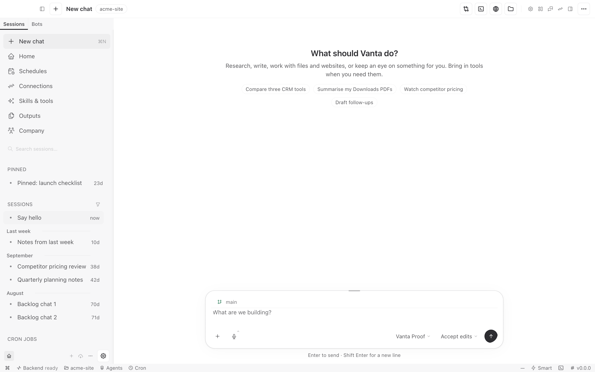
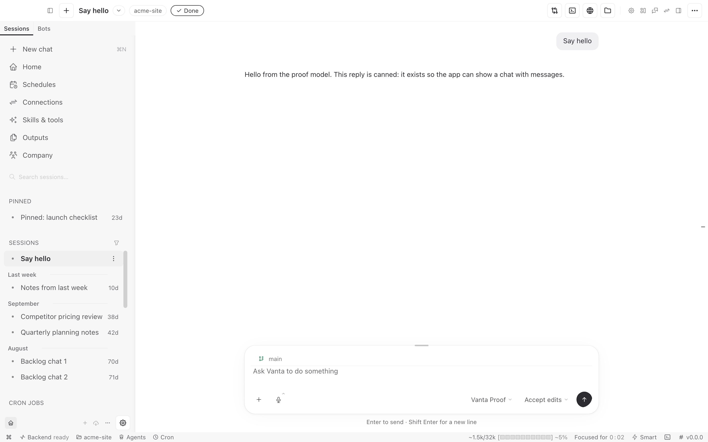
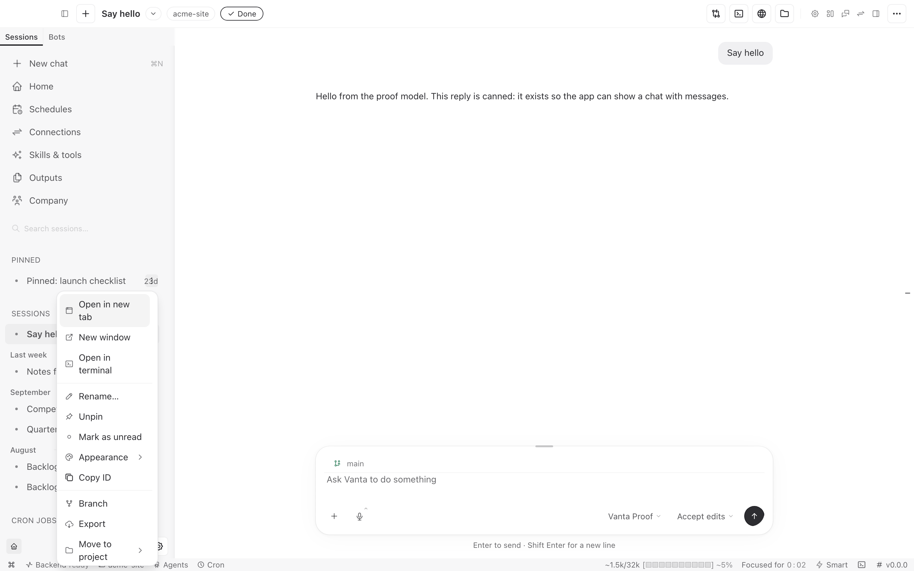
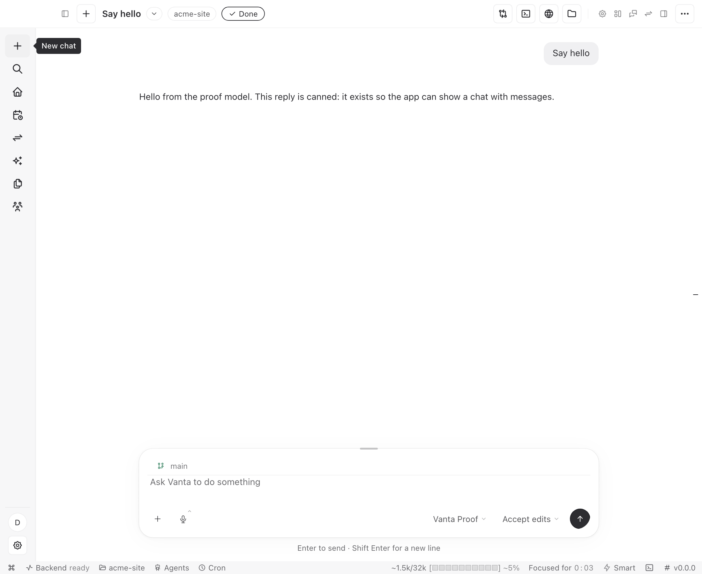

# DN-29 — sidebar and composer review candidate

2026-10-23. **Source preview; owner visual review pending. Not installed or released.**

The owner authorized these two surfaces and asked to see them before proceeding.
Their final Git instruction was no commit or push yet; no commit, push or tag
was performed. The branch remains `claude/desktop-integration-20261013` at
`0b2f2dff8eb0b4bd0ecaf566116c204cadd13f35` during this slice.

## Actual running app

These are Electron screenshots, not HTML mockups. The existing proof launcher
used a separate profile/home and a scripted local model. Chats and projects in
the pictures are test fixtures, not the owner's data. Captures are 1440×900 CSS
pixels at 2× device scale; the narrow capture is 800×900 CSS pixels.

### New chat

### Conversation

### Keyboard actions

Other captures: [before](proofs/dn29-sidebar-composer-2026-10-23/00-before.png),
[editable draft](proofs/dn29-sidebar-composer-2026-10-23/03-composer-draft.png),
[narrow layout](proofs/dn29-sidebar-composer-2026-10-23/05-chat-narrow.png),
[dark mode](proofs/dn29-sidebar-composer-2026-10-23/06-chat-dark.png).

## What changed

- Composer: the wireframe's 22px radius, opaque white/light or existing dark
  surface, restrained layered elevation and quiet typing-focus edge.
- Utility/model/permission controls: borderless resting state, existing menus
  and behavior, explicit keyboard-focus rings on buttons.
- Sidebar: soft inset edge depth; existing width, destinations, groups and
  capabilities retained. Full sidebar reuses the existing localized New chat
  label rather than New session.
- Session-row actions: keyboard focus reveals the same menu as hover, without
  changing row width. A visually replaced timestamp cannot retain invisible
  keyboard focus.

The static installed reference in
`REACHABILITY-AND-REFERENCE-2026-10-23.md` informed spacing/elevation; the approved
wireframe still governs structure. No proprietary source, icons or fonts were
copied. Gestalt proximity/grid rhythm and scoped CSS tokens were applied; no new
component framework, settings, storage or backend was introduced.

## Verification executed

Commands run from `desktop-next` unless a different directory is shown.

| Command | Exit | Evidence and limit |
| --- | --- | --- |
| `node tools/build-vanta.mjs` | 0 | Final source renderer, Electron and runtime bundles built. This is not packaging/signing/install acceptance. |
| From `apps/desktop`: `npx vitest run src/styles/design-guard.test.ts src/app/chat/composer/model-pill.test.tsx src/app/chat/composer/permission-chip.test.tsx` | 0 | 30 tests passed. |
| From `apps/desktop`: `npx vitest run src/app/chat/sidebar/chat-sidebar.integration.test.tsx` | 0 | 11 tests passed. |
| From `apps/desktop`: `npx vitest run src/styles/design-guard.test.ts` after the final styles | 0 | Seven guard tests passed; no baseline regeneration. |
| `VANTA_KERNEL_BIN=/Users/jasonpoindexter/Documents/GitHub/docs/Vanta-kernel-closeout-20261014/target/release/vanta-kernel node tools/proof/dn29-surfaces.mjs` | 0 | 22 source-app assertions and six screenshots. New chat/draft, keyboard menu/focus, model and permission menus, image/folder attachments, 800px fit and actual dark-theme switch. Native file dialogs are stubbed; model is scripted. |
| From `vanta-ts`: `node --import tsx src/cli.ts lint --baseline /Users/jasonpoindexter/Documents/GitHub/docs/Vanta-integration-20261013/desktop-next/apps/desktop/src/app/chat/sidebar/index.tsx` | 0 | One changed production TSX file; no new/worse size violations. Five inherited violations remain. |
| `node --check tools/proof/dn29-surfaces.mjs` | 0 | New focused proof syntax. |
| `node tools/brand/brand-scan.mjs` | 0 | Zero matches. |
| `git diff --check` | 0 | Whitespace check, not behavior proof. |

The final executed assertion ledger is
[`review-results.json`](proofs/dn29-sidebar-composer-2026-10-23/review-results.json).
No full-suite or full-inventory reachability rerun was used for this slice.

Failed checks were investigated, not retried blindly: the first keyboard probe
found the visually hidden timestamp remained in Tab order; visibility handling
was corrected. A proof caller initially supplied the raw Electron object to an
attachment helper expecting the launcher context; the caller was corrected,
not product code. The first button-ring assertion found the legacy composer's
blanket outline suppression; the scoped button ring was restored and the final
real-window assertion passed. Earlier failed-run sandboxes were retained.

## Preservation and inventory

All 169 pre-existing modified/untracked regular files were hash-checked against
the start of this slice: zero changed or missing. This includes the four
inherited source/test edits, prior proof corrections/documents and every
inherited done-path artifact. No normal-profile state, credentials, licenses,
Rust, factory, application bundle or installed launcher was changed.

Production edits: `src/styles.css`, `src/styles/vanta.css`,
`src/styles/vanta-sidebar.css`, `src/styles/vanta-composer.css` and the localized
label mapping in `src/app/chat/sidebar/index.tsx`, all under `apps/desktop`.
Supporting edits: `apps/desktop/DESIGN.md`, `docs/DESIGN-TOKENS.md`, the status
log, this review and the focused proof/captures. Existing unrelated work remains
uncommitted and untouched. No Git index writes were performed.

## Hold here

DN-29 remains open. This does not finish the Codex-like shell, navigation
hierarchy, transcript/activity presentation or token unification. The technical
titlebar, status stack and bottom runtime strip were deliberately not redesigned
in this slice. The two known unsupported shim errors (`desktopPluginsRoot`,
`getRemoteDisplayReason`) still appear. Build warnings about font resolution and
chunk configuration also remain.

Await owner visual review before another surface. No live-provider run,
screen-reader/complete accessibility audit, forced-colors execution, packaging,
signing, installation, publication, release or GitHub/Trello mutation is claimed.

## Continued review: compact rail and live window

The 1,100px compact rail was missing visible hover labels despite having
accessible names. `sidebar/vanta/sidebar-nav.tsx` now reuses `Tip`, positioned
outside the rail's clipping boundary, for actions and destinations. The full
sidebar's existing session-action control now uses the horizontal ellipsis;
its menu and actions are unchanged. No new navigation or data state was added.

- `node tools/build-vanta.mjs`: exit 0 after the two production edits.
- From `apps/desktop`, `npx vitest run src/app/chat/sidebar/session-row.test.tsx`:
  exit 0, 14 passed.
- `VANTA_KERNEL_BIN=/Users/jasonpoindexter/Documents/GitHub/docs/Vanta-kernel-closeout-20261014/target/release/vanta-kernel node tools/proof/dn29-rail.mjs`:
  exit 0, seven assertions. Hover New chat/Home, label outside the rail, keyboard
  Search label, Escape dismissal, forced-colors composer edge, and real row-menu
  opening. An initial immediate post-Escape count raced the tooltip's exit;
  the proof now waits for hidden state rather than changing product behavior.
- Explicit size lint with `--baseline` over the two changed sidebar files:
  exit 0; six inherited violations, none new or worse. No baseline rewritten.
- Syntax, brand scan (zero matches), and `git diff --check`: exit 0.
- A visible source-app window was launched in a separate sandbox and raised
  through the native UI tool. Its accessibility tree confirms New chat, Message
  Vanta, the model control, permission control and disabled empty Send button.
  This is not a normal-profile or installed-app acceptance run. The preview is
  left open for owner inspection; its model is scripted and its chats are fixtures.
- Live Codex inspection was refused by the UI tool for safety reasons, not a
  locked Mac. That restriction was not bypassed; the previous supplied captures
  and static evidence remain the reference.

[Forced-colors capture](proofs/dn29-rail-2026-10-23/rail-forced-colors.png),
[row menu](proofs/dn29-rail-2026-10-23/row-menu.png),
[executed assertion ledger](proofs/dn29-rail-2026-10-23/rail-review.json).

The seven new assertions do not replace or rerun the earlier 22. Reduced motion
was enabled during the forced-colors capture; a complete motion audit or
screen-reader run was not performed. Both known unsupported shim errors remain.
No titlebar, transcript, runtime-strip, plan-card or owner-gated workflow change
was started. No commit, push, tag or install was performed.
