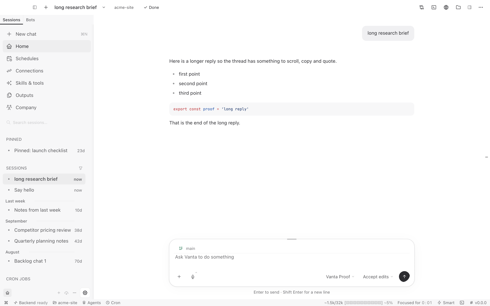

# DN-29: titlebar and transcript source preview — 2026-10-23

Owner authorized this surface after the sidebar/composer candidate, with no
commit or push. Target is `Vanta-integration-20261013`, branch
`claude/desktop-integration-20261013`, HEAD
`0b2f2dff8eb0b4bd0ecaf566116c204cadd13f35`. The installed application and normal
profile are not replaced. All inherited work is preserved.

## Change and scope

- `pane-toggles.tsx`: reuse More for settings, layout, HUD and pane-side swap;
  direct Changes, Terminal, Browser, Files and right-pane controls remain.
  Existing tooltip primitive labels the four workbench icons.
- `vanta-shell.css`: transparent resting chrome, quiet medium-weight title,
  capped project chip, explicit hover/pressed/focus states. The 44px drag strip
  and native-window-control clearance are unchanged.
- `vanta-chat.css`: same 720px column and 14px body; 24px turn separation, 32px
  top inset, right-aligned user messages capped at 85%, padded tool disclosures.
  No rendering/runtime/approval handlers changed.
- Reachability helpers follow the relocated More controls and the current
  Always button label. The first approval check failed on the old label;
  product authority was not loosened to satisfy it.

Design reasoning: cognitive-load reduction through progressive disclosure,
spacing/proximity for conversation hierarchy, semantic color/elevation tokens,
and visible keyboard state. Existing Radix and disclosure primitives are reused;
no dependency, new preference, engine or copied product assets.

## Verification ledger

Commands run from `desktop-next` unless otherwise stated:

| Executed gate | Exit | Evidence and limits |
| --- | --- | --- |
| `node tools/build-vanta.mjs` | 0 | Rebuilt renderer, Electron bundles and runtime after final production edit; not a package/install. |
| From `apps/desktop`: `npx vitest run --project ui src/app/shell/titlebar-controls.test.tsx src/app/shell/vanta/project-chip.test.tsx src/components/assistant-ui/thread/response-copy-scope.test.tsx src/styles/design-guard.test.ts` | 0 | 26 passed in four files. |
| From `apps/desktop`: `npx vitest run --project ui src/components/assistant-ui/thread/streaming.test.tsx src/components/chat/vanta/approval-card.test.tsx src/styles/design-guard.test.ts` | 0 | 32 passed in three files. Seven guard cases repeat: 51 distinct focused tests across both commands. jsdom canvas warning remains. |
| `VANTA_KERNEL_BIN=/Users/jasonpoindexter/Documents/GitHub/docs/Vanta-kernel-closeout-20261014/target/release/vanta-kernel node tools/proof/dn29-titlebar-thread.mjs` | 0 | 26 assertions in the real source Electron app: quiet chrome, keyboard More, all advanced menu entries, project actions, bounded transcript, code/list formatting, actual copied text, executed sandbox shell activity, expand/collapse, three approval choices and Reject, 800px titlebar fit, dark preference. Scripted model, separate HOME/VANTA_HOME; not real-provider proof. |
| From `vanta-ts`: `node --import tsx src/cli.ts lint --baseline /Users/jasonpoindexter/Documents/GitHub/docs/Vanta-integration-20261013/desktop-next/apps/desktop/src/app/shell/vanta/pane-toggles.tsx` | 0 | Changed production TSX file within all 300/50/4/10 limits; no baseline update. |
| `node tools/brand/brand-scan.mjs` | 0 | Zero matches. |
| `node --check` on the new proof and changed `rows-chrome.mjs` / `rows-thread.mjs`; `git diff --check` | 0 | Syntax/whitespace only. |

The updated `rows-chrome.titlebar` helper also ran in the visible preview:
seven PASS, one retained INERT (HUD), two NOT-RUN (unread badge/plugin slots),
one existing DROPPED preference. Presence checks do not prove settings, layout
editor or HUD backend behavior. The HUD remains unsupported; no new mini-window
claim. The first 19 assertions passed before a stale Always locator stopped the
initial run; no product policy was changed and only the narrow proof was rerun.

The final candidate is open in a native window, raised and observed through the
native accessibility tree and screenshot. It shows the actual long-reply fixture,
list/code, new titlebar and editable composer. The earlier preview process was
gracefully quit only to disambiguate identical Electron bundle IDs; its separate
scratch profile was retained. Current review profile:
`/var/folders/rj/nj_9qs2s7zs52nsc90yl2q700000gn/T/vanta-desktop-XJIiG5`.

[Menu](proofs/dn29-titlebar-transcript-2026-10-23/01-titlebar-menu.png),
[tool activity](proofs/dn29-titlebar-transcript-2026-10-23/03-tool-activity.png),
[narrow](proofs/dn29-titlebar-transcript-2026-10-23/04-narrow.png),
[dark](proofs/dn29-titlebar-transcript-2026-10-23/05-dark.png),
[26-assertion ledger](proofs/dn29-titlebar-transcript-2026-10-23/titlebar-thread-review.json).

HEAD remains unchanged and nothing is staged. The original 165 inherited files
and all 169 files captured before the sidebar/composer work remain byte-identical.
The current turn's 194-file snapshot changes only the three explicitly extended
design/status documents; all other existing dirty-file bytes are retained.
The three scoped production files and two proof helpers were clean when that
snapshot was captured; their diff is listed above. The new review script and
evidence are additive. DN-29 remains open for
owner review and its larger migration contract.

## Trello and acceptance boundary

[DN-29](https://trello.com/c/FlseDRro) records the current scope and source-only
evidence. The board's Start here card now points to this checkout/handoff;
October 8 counts and branch pointers are retained only as a historical snapshot.
No duplicate board/cards, invented deadline, mass Done moves or product-status
changes. DN-13 full acceptance and DN-33 owner decisions remain open.

Not checked: a real-provider business task, long-history performance, full suite,
complete accessibility/VoiceOver, native installed build, packaging, signing or
release. Runtime strip and broader navigation/token migration are outside this
slice. Known unsupported `desktopPluginsRoot` and `getRemoteDisplayReason` shim
errors and inherited font/chunk build warnings remain; this is not zero-error
application acceptance. No commit, push, tag, install or live account mutation.
