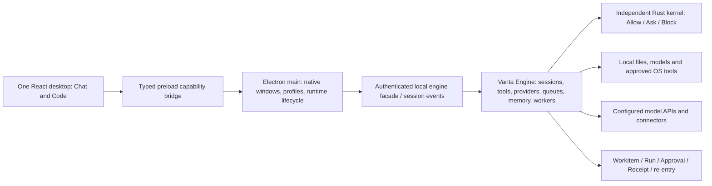

# Vanta desktop: Claude interface, Vanta capabilities

Review candidate, 16 October 2026. Owner: Jason. Status: proposed; application implementation is not authorized by this document.

## The decision

Recreate Claude Desktop’s interface and its Chat / Code switch closely, using Vanta’s existing engine and capabilities. Keep a single installed Vanta application. Replace the Hermes-derived default interaction and visual presentation in place, retaining useful shell infrastructure rather than starting another runtime or application fork.

The initial prototype was too loosely styled and represented too few features. This revision follows the installed Claude reference: a 288 CSS-pixel sidebar, compact session header, project-grouped conversations, understated navigation, a central conversation, detached prompt options, and individually collapsible context cards. Chat and Code are prominent peers. The footer is **Profiles**, with no Vanta account login/logout system. Claude-only capabilities are not requirements.

The interactive prototype is a design review artifact. It uses synthetic data and browser-local state. Its sample approvals, workers, terminal, connections, schedules, and receipts do not execute Vanta, contact providers, operate the OS, or prove native behavior.

## Evidence and its boundaries

The investigation used read-only repository and installed-app inspection, REA static analysis, official Anthropic documentation, and observation of the running native windows. No test prompts were submitted to Claude or Vanta. Native-app observations were limited to the visible interface; private conversation content is not reproduced in this report or prototype.

| Evidence | What it establishes | What it does not establish |
| --- | --- | --- |
| Installed Claude 2.42304.0; ASAR SHA-256 `bfa22ac393906762fa04b9607ff202907405b089c1ae7db257159202f31bb3d0` | Exact inspected artifact identity; package declares Electron app entry and React-related build dependencies | Complete source, reachable behavior of all bundled modules, cloud internals |
| REA Claude inventory and selected-source analysis, `evidence/claude-rea-summary.json` | Inert parsing of three selected JS sources; context-bridge and IPC syntax observations | Whole-app semantic coverage, channel pairing, registration or enforcement at runtime; analysis is explicitly partial |
| `evidence/claude-static-excerpts.json` | Exact artifact paths and character offsets for hosted origins, WebContentsView construction, preload exposure, web preferences, file-index worker, and MCP config references | That every observed branch is reachable, or that a bundled SSE client is necessarily the chat stream implementation |
| Claude native accessibility tree and screenshots | Project-grouped sessions; mode switch; composer; model/permission controls; Files, Changes, Terminal, Browser; Environment, Context, Connectors, Outputs, Changes, and Background tasks cards; sidebar AX width 288 | That all actions behind these controls work, or that documentation exactly matches this account/build |
| Installed Vanta 0.1.0; ASAR SHA-256 `9b0daa540d604c02c6c84776307005b807d8485d3d528957b071c781ecee90ba` | Packaged renderer and preload identity; `vantaBuild.commit=0bc61361`, built at `2026-10-16T07:25:59.986Z` | Clean source-to-package equivalence, because the checkout also contains uncommitted work |
| REA Vanta preload analysis, `evidence/vanta-rea-summary.json` | Partial static bridge/IPC observations in `dist/electron-preload.js` | Full bridge isolation, security clearance, or runtime parity |
| Running Vanta native window | Current Home, conversations, profiles, titlebar pane toggles, provider/mode controls, backend transition from starting/offline to ready | New live-provider, microphone, native tool, authenticated connector, or unattended-work acceptance |
| Inspected Vanta source and current product contracts | Concrete existing adapters, routes, data models, preservation requirements, and architectural seams | Fresh execution of each feature or historical proof claim |

REA found eight declared-versus-observed ASAR integrity contradictions in Claude’s unpacked companion files. Inspection retained them as observed-untrusted using record-and-continue. The tool notes that signing/stripping can cause this class of mismatch; the cause here was not determined. This investigation is not a security diagnosis of Claude.

**Why REA, rather than Hopper/Ghidra:** the design questions primarily concern Electron, packaged JavaScript, local/hosted UI boundaries, and visible workflows. REA could inspect those directly. Ghidra was not used: native disassembly would not recover Anthropic’s hosted UI or model backend, and no unresolved native function was necessary to choose this redesign. Hopper was not used.

## Source reconciliation

Prior project guidance identifies `docs/Vanta-librechat-shell-adapter-20261002` as the governing historical checkout. Its inspected HEAD was `92ee5c8643b188eda4349f89fac40533c681d252`, with an existing deleted `vanta-ts/package.json` and untracked `handoffs/`. Neither is repaired or committed here.

The installed app points to the newer `docs/Vanta-integration-20261013` checkout, HEAD `0bc61361eee4c4b1ef677c78de4c1b84904b6eac` at inspection. That checkout contained substantial existing modifications. It is the implementation evidence target and the user-authorized checkpoint-commit target. The redesign artifacts live separately from application code. No claim is made that all uncommitted work was present in the installed package.

`MANIFESTO.md`, append-only `DECISIONS.md`, `STRATEGY.md`, `roadmap.json`, `docs/prd.md`, and `docs/product-acceptance.md` remain governing. The inspected integration roadmap contained 1,364 records: 1,289 shipped, 63 parked, six horizon, four next, and two building. These are database statuses, not 1,289 newly verified capabilities. This plan does not change them or create a second product backlog.

## What Claude teaches us

**Observed:** one application can organize general conversation and repository work behind a prominent mode control. The Code workspace puts project context and review tools next to the conversation. Tool activity can collapse without concealing its details. Workbench panes need not permanently consume the conversation width.

**Documented:** Anthropic describes independently scoped sessions, permission choices, contextual file input, and reviewable changes in its [desktop reference](https://code.claude.com/docs/en/desktop). These support Vanta’s proposed interaction sequence: choose context → describe outcome → inspect progress → review action/output → resume. Treat documentation as reference behavior rather than proof of every installed control.

**Documented:** Anthropic distinguishes remote service connectors from local desktop extensions in its [connector guide](https://support.claude.com/en/articles/11725091-when-to-use-desktop-and-web-connectors). Vanta should make host and account scope equally legible instead of presenting every connection as interchangeable.

**Documented:** Claude’s [artifact guide](https://support.claude.com/en/articles/17153992-what-are-artifacts-and-how-do-i-use-them) describes working with outputs alongside a conversation. Vanta already has outputs, document previews, and canvas, so the relevant adaptation is placement and continuity rather than inventing a new output runtime.

**Inferred:** Claude’s separation between desktop chrome/local capabilities and a hosted web experience helps it change the product without packaging every visible feature. Vanta can adopt the interaction pattern while retaining its local-first renderer and engine. Reproducing Anthropic’s hosting architecture is not necessary for visual/workflow fidelity.

**Unknown:** Claude’s server-side message persistence schema, routing strategy, full model/tool orchestration, retry/idempotency semantics, private APIs, and internal permission enforcement. The installed files do not justify recreating these as alleged facts. No authenticated network capture or runtime instrumentation was performed.

## The full product experience

### One app, Chat and Code

The upper-left segmented control reads **Chat | Code**. It is a workspace presentation choice, separate from autonomy and permission modes.

| Concern | Chat | Code | Shared rule |
| --- | --- | --- | --- |
| Primary work | Research, writing, planning, life administration, communication preparation, continuity | Repository exploration, implementation, debugging, review, development previews | Both use Vanta Engine and the same trust boundary |
| Starting point | Conversation or Today; project optional until the task needs one | Select a project/repository, host, model, and permission mode | Do not demand unnecessary taxonomy before capture |
| Sidebar | Conversations grouped by project; personal work remains possible | Repository-grouped sessions with status and lineage | Pin, rename, search, archive, fork, tab/window actions remain |
| Composer | Files, images, voice, screenshots, skills, connectors | Same inputs plus file/path context and repository scope | Unsent text and attachments belong to session + profile, never a global scratch buffer |
| Right rail | Task outcome, sources, connections, outputs, follow-up | Environment, context, connections, outputs, plan, changes, background tasks | Collapse/reopen without losing state; no background focus stealing |
| Tools | Available when the task and authority permit | Development tools foregrounded | Code is not a permission grant; Chat is not an artificial capability restriction |
| Return | Saved conversation, draft, reading anchor, next action | Saved session, repository/worktree, panes, draft, terminal state where supported | Restore explicit re-entry, not a fresh greeting that loses the thread |

Each mode remembers its selected session and layout. A round trip Chat → Code → Chat must restore the original draft and context. Per-profile state stays separate. Cross-mode handoff previews the selected project, included context, and intended next step; it prepares a new draft rather than silently sending or duplicating work.

The full product keeps profile identity independent from app authentication. The bottom-left control opens local profiles. Create, switch, clone, import, and export remain available. Providers and connectors may require their own credentials or OAuth; those flows remain under their own settings. Profile import must not transfer credentials, standing grants, signing state, trusted-device status, or safety authority.

### Layout and design contract

Use the installed Claude window as the visual acceptance reference, not a generic “AI app” template. Preserve its spatial hierarchy: compact sidebar chrome, full-width Chat/Code segment, New, Outputs, Customize, More, grouped projects, and profile footer. Vanta labels and Vanta destinations replace Claude-only product items.

The prototype uses a 288px sidebar measured from Claude’s AX splitter, a compact 48px session header, a roughly 720px conversation target, and a 304px context rail at its 1440px desktop reference. These latter values are authored matching choices, not claimed extracted Claude CSS. Typography uses the system sans stack and system monospace. No Claude fonts, icons, application code, or private conversation content were copied into the prototype.

Neutral surfaces, quiet selection fills, restrained borders, and rounded context cards follow the reference. Violet remains primarily a Vanta focus/link accent. The prompt options sit below the bordered composer, rather than turning it into a dense settings form. The session title opens its menu; pane buttons stay in the same upper-right order. Avoid a second row of competing global status badges.

Desktop layouts retain resizing, splits, tabs, detached windows, saved layouts, pane swaps, and Simple/Advanced presentation. Those are advanced controls, not a mandatory setup task. At narrower widths, the sidebar becomes a drawer and a workbench overlays rather than crushing the conversation. Native window controls are provided by the actual Electron window, not simulated browser buttons in the shipping app.

### Core flows

1. **Start and continue:** select a profile/project, capture a task, preserve input immediately, run within authority, show one truthful state, retain partial output, and present the next action on return. Project switching previews the destination and carries the draft once.
2. **Chat → Code:** prepare research/brief in Chat; choose Open in Code; review included context and destination; restore as a Code draft; select permission independently; begin only on Send. Retain the source Chat and provenance link.
3. **Supervise:** show collapsed tool groups, accessible progress, a stable reading anchor, Stop, and explicit queue editing. A hidden pane does not end its process. Background completion offers navigation rather than forcing it.
4. **Approve:** use one approval renderer for chat, skills, workers, connection setup, and background requests. Show exact target, account/recipient where applicable, effect, scope, expiry, and one-use authority. A changed action invalidates the old approval. Kernel Block remains final.
5. **Close with evidence:** `unverified` after a run ends; `verified` only after the declared Done criterion executes. A stopped/failed run keeps partial output, reason, and offered recovery actions. Never collapse “response ended,” “action succeeded,” and “outcome verified” into Done.
6. **Queue and recover:** enqueue, edit, reorder, cancel, steer, and retry using revisions. Stale revisions reconcile explicitly. Saved offline input does not auto-send on reconnection or relaunch. Unknown external effects require reconciliation before replay.
7. **Operate beyond coding:** Today carries capture, one recommendation, prepared action, Waiting/Needs You, follow-up, and re-entry. Support has show/do/snooze/skip/off controls, explicit scopes, quiet hours, and seven optional capacity dimensions, initially unknown. No diagnosis inference or guilt mechanics.
8. **Produce and reuse:** generated files and canvas appear as output cards with provenance. Open preview on user intent. Library includes files, links, saved runs, workflow history, and memory. Reuse prepares a forked draft; it does not silently replay historical writes.

## Complete preservation map

`FEATURE-PRESERVATION.csv` has **296 unique IDs**: all 245 rows of the existing shell preservation matrix and all 51 rows of the Vanta cutover matrix. Original inventory rows and source lines are retained. They remain dated observations; later source and receipts must supersede stale cells individually.

### Shell feature families

| Existing family | Entries | Destination and preservation rule |
| --- | ---: | --- |
| Titlebar | 11 | Session title/menu, pane strip, View menu; retain plugin slots, window controls, unread/status semantics |
| Sidebar top | 14 | New/Outputs/Customize/More and project groups; retain contributed destinations, search, resize, tips and interface tiers |
| Sidebar sessions | 32 | Grouping, pin order, statuses, row menus, gestures, archive, bulk actions, project lanes and error recovery |
| Bots tab | 8 | Workers & budgets advanced view; retain runtime/worker capability and route, not a second default operator identity |
| Profile rail | 11 | Profiles footer and management view; retain local/remote routing and isolation |
| Composer | 28 | Both modes; retain attachments, clipboard, voice, slash commands, models, effort, queue, permissions and IME/keyboard behavior |
| Thread | 13 | Conversation; retain versions, actions, branching, checkpoints, reading anchors, schema diagnostics and interrupted output |
| Workbench | 20 | Context cards and Files/Changes/Terminal/Browser/Outputs; retain lifetimes, layout and document behavior |
| Pages/overlays | 21 | Existing routes remain reachable through primary navigation, Customize, More or command palette |
| Settings | 26 | Preserve every supported current category; do not resurrect unsupported Hermes backend settings as working |
| Status bar | 17 | One compact runtime summary plus diagnostics; preserve information without showing every fact continuously |
| Native menu/tray | 17 | Preserve tray, shortcuts, badges, mini window, updater and platform behavior |
| Command palette | 9 | Shared keyboard route to existing commands, profiles, panes and capabilities |
| Context menus | 5 | Preserve object-specific operations and keyboard equivalents |
| Onboarding | 13 | Honest provider setup, first launch, reconnect and unsupported-capability states |

A historical `DROP-NEEDS-OWNER-OK` row stays reachable until its particular retirement is approved. Moving a control is not permission to delete its feature.

### Every Vanta-specific capability

| ID | Capability | Proposed home / requirement |
| --- | --- | --- |
| V-001 | Selection/window/screen capture | Attach menu in both modes; OS permission, cancellation and denial recovery |
| V-002 | Files/folders/context attachments | Composer chips; scope, symlink/private-file rules and input limits retained |
| V-003 | Clipboard text/images | Composer paste and native bridge; no accidental upload or context switch |
| V-004 | Local Whisper dictation | Composer microphone; actual local availability shown |
| V-005 | Hey Vanta wake word | Voice settings/tray with opt-in, listening status and Off |
| V-006 | Durable queued-turn editor | Composer queue; revisions, edit, move, cancel, steer, retry, explicit resume |
| V-007 | Long-session navigation | Timeline, prompt markers, reading-anchor restore and jump-to-latest |
| V-008 | Receipt recovery | Inline stopped/error result and Task context; only server-offered recovery actions |
| V-009 | Schema trace/counterexample | Expandable structured-output diagnostics beside the relevant result |
| V-010 | Outcome/next-action dossier | Task context and durable re-entry summary |
| V-011 | Model/effort/speed/route status | Detached composer controls; route/cost/auth details on demand |
| V-012 | Provider setup | Models & providers; API key/local/custom endpoint paths |
| V-013 | Provider auth recovery | Inline reconnect with saved request; explicit retry |
| V-014 | Server-persisted drafts | Per profile/project/session; migrate existing drafts once |
| V-015 | Session management | Project sidebar, title menu, palette and archive/bulk view |
| V-016 | Palette/shortcuts | Shared shell, including existing access-mode shortcut |
| V-017 | Welcome/early composer/theme | True empty state; input available while runtime starts |
| V-018 | Five permission presets | Composer and settings; distinct from R0–R5 and kernel decision |
| V-019 | Full-access acknowledgement | Existing versioned per-project warning; no silent widening |
| V-020 | Scoped exact-action approval | Single renderer, including out-of-chat requests; no unsafe Always |
| V-021 | Boundary token/origin checks | Main/engine boundary; never move secrets into renderer |
| V-022 | Mic permission isolation | Main-process media policy; denied and revoked states |
| V-023 | Chart/table/board canvas | Output card and workbench, retaining tool-eligibility disclosure |
| V-024 | Files/Review/Terminal | Code foreground; available contextually in Chat; preserve gated commands |
| V-025 | Document previews/links | Workbench viewer and explicit external-open controls |
| V-026 | Outputs/artifacts | Outputs navigation, context cards, and Library |
| V-027 | Skills/tools | Customize with installed inventory, hub preview and approvals |
| V-028 | Today continuity | More → Today / Chat landing; no taxonomy requirement; optional support |
| V-029 | Workflow ledger | Automations workflow runs and run details; checkpoint acknowledgements |
| V-030 | Saved run library | Library → Runs; search/save/fork; replay/drift remains gated where not built |
| V-031 | Execution contract/Runs summary | Task context and run details; preserve semantic content rather than Classic-only UI |
| V-032 | Schedules | More → Automations; time zone, host, missed wake, last/next run, pause/cancel |
| V-033 | Release-proofs dashboard | Prior explicit owner-approved retirement; do not restore automatically |
| V-034 | MCP trust/policy/status | Connections; inspect, trust, deny, revoke and capability state |
| V-035 | Integration catalog | Connections: existing Trello/Dropbox/Box/Google/Rovo/Slack/Telegram paths |
| V-036 | Google Workspace | Separate account binding and consent/setup; no fictitious connected state |
| V-037 | Messaging/gateway/Telegram | Connections → Messaging; platform readiness and gateway lifetime |
| V-038 | LAN companion/pairing | Settings → Devices; retain separate deferred status and paired-host scope |
| V-039 | Native iOS wrapper | Prior explicit owner-approved retirement; LAN companion remains separate |
| V-040 | Public API | Settings → Advanced/API; preserve existing API, no redesign prerequisite |
| V-041 | Runtime controller/strip | Compact runtime footer and diagnostics/restart; real lifecycle facts |
| V-042 | Runtime profiles | Profiles footer: create, clone, select, import, export; no app login/logout |
| V-043 | Model-download queue | Models & providers → Downloads; progress, cancel, disk/error states |
| V-044 | Cross-project task handoff | Preview target/context; carry draft exactly once through runtime switch |
| V-045 | Full/mini window | View menu, tray and shortcuts; same task/runtime identity |
| V-046 | Avatar presence window | Prior explicit owner-approved retirement; do not revive it as required UI |
| V-047 | Tray | Native tray menu: status, pending decisions, wake controls and compact entry |
| V-048 | Completion sound | Optional attention setting; quiet-hours/meaningful-change rules |
| V-049 | Offline/connection/first launch | Distinct states; saved drafts, bounded retry, actionable recovery |
| V-050 | Packaging/signing/notarization/update | Keep packaging infrastructure and validate the exact candidate |
| V-051 | Company/workers/tickets/budgets/activity | More → Workers & budgets; existing routes and capabilities retained |

Old cutover descriptions such as “missing” for canvas or run library conflict with later dated source notes. The redesign does not freeze those old statuses. It preserves the capability and requires fresh packaged proof of its current destination. The three prior retirements above come from the existing owner-decision section, not a new deletion decision in this review.

## Architecture: retain the engine, recompose the desktop

Reuse Electron, React, the existing stores/query layer, Zod schemas, session adapters, pane registry and layout tree. Keep UI ephemeral state in the renderer; machine/runtime facts in main; work, model calls, queues and effects in Engine. The shell must not implement another agent loop, scheduler, memory database, or permission engine.

Concrete inspected seams:

- `desktop-next/apps/desktop/src/app/routes.ts`: existing pages and contributed routes. Keep deep links; the new sidebar is a projection over the same routes.
- `.../src/app/chat/sidebar/vanta/destinations.ts`: current Home/Schedules/Connections/Skills/Outputs/Company projection. Replace the default presentation, not the route ownership.
- `.../src/api/vanta/dispatch.ts` and `handlers-prompt.ts`: current RPC-to-Vanta adapter, durable queue and turn handoff. Preserve rather than reproduce backend work in React.
- `.../electron/vanta/launcher.ts`: authenticated startup probe, main-held boundary token, process lifetime and packaged runtime. Keep these behind the bridge.
- `.../electron/vanta/window-host.ts`: native window and navigation handling. Changes to visual chrome must not widen navigation or capability access.
- `.../src/app/vanta/home/today-model.ts` and `today-section.tsx`: seven capacity dimensions, refusal scope, capture and recommendation actions. Retain the real contract.
- `.../src/app/settings/settings-extras.ts`: unsupported Hermes-only pages are already explicitly hidden. Do not make them appear enabled just to imitate Claude.

### Proposed UI contract additions

Add a presentation state keyed by `(profileId, projectId, surfaceMode, sessionId)`: `surfaceMode = chat | code`, selected session, draft revision, reading anchor, open panes, sizes, selected output, and return context. Reuse existing durable IDs; do not derive identity from a tab label or runtime process ID.

Backend work state stays exactly: `draft → queued → running → waiting → needs human → stopped → failed → unverified → verified` as allowed by existing transitions. This is an enumeration, not a requirement to traverse every value. `denied`, `expired`, `unknown`, and `compensated` remain action/receipt dispositions. Existing R0–R5 labels remain autonomy only. No new risk level or shell mode grants authority.

Bridge failures need typed outcomes with recovery: unsupported capability, offline, auth required, stale revision, scope mismatch, approval expired, denied, blocked, interrupted, and unknown effect. The UI must not retry writes generically after transport failure. Approval payloads bind exact parameters, target/account, capability, expiry and one-use scope. Imports and mode changes never manufacture authority.

### Services required

No new hosted backend is required for the redesign. Keep the existing local runtime, kernel, storage, model providers, and native bridge. Cloud model APIs require the user’s configured provider credentials and incur provider usage only when actually used; local models remain an alternative with honest tool/capability limits. Local Whisper covers existing offline dictation; optional remote speech services remain optional. Connector-specific OAuth/MCP services are needed only for enabled integrations. Remote execution/always-on scheduling requires an explicitly configured host; an asleep Mac is not one.

Keep signing/notarization/update infrastructure, secure credential storage, and any already configured connector or worker runtime. No subscription, account, API key, deployment, or paid service is created by this work.

## Migration and full implementation sequence

This is the complete destination, delivered through dependency-ordered slices. It is not a proposal to replace Vanta with a small demo.

| Phase | Outcome and scope | Exit evidence |
| --- | --- | --- |
| 0: Freeze the comparison | Record exact candidate, inventory IDs, current package, outstanding source changes and approved prior retirements | Every retained feature mapped to old route, new route, owner and behavioral criterion; recoverable snapshot |
| 1: Faithful shared shell | Claude-like layout, Chat/Code switch, project groups, Profiles, palette, native menus and responsive defaults; no runtime rewrite | Same profile/session round trip preserves drafts, attachments, reading anchor and panes; keyboard and screenshot review against reference |
| 2: Conversation completeness | Streaming/stop, tool summaries, long-session navigation, queue editor, model/effort/permission controls, attachments/voice/capture and session operations | Real model and tool paths on packaged app; IME, paste, selection, queue revisions and cancellation exercised |
| 3: Trustworthy review/workbench | Exact approval, changes, files, terminal, browser/preview, outputs, canvas, schema trace and receipts | Approval decision reaches the actual blocked tool; scope change invalidates it; completion stays unverified until the real criterion passes |
| 4: Operator continuity | Today, durable drafts/re-entry, waiting/follow-up, support refusal/expiry, quiet proactivity, offline and reconnect | Real restart and project/profile switch retain context; refusal suppresses repeated nudges; no automatic replay of uncertain effects |
| 5: Extensibility and breadth | Supported providers/downloads, skill hub, tools/plugins, local/remote MCP, integration catalog, messaging, profile management and existing advanced settings | Each old supported path reaches its new destination; credentials stay out of renderer/export; unsupported features show a reason |
| 6: Background work | Existing schedules, workflow ledger, saved runs, workers, tickets, budgets, activity, API and companion boundary | Actual host sleep/offline/missed-trigger truth; requested pause differs from acknowledged pause; budgets and authority remain bounded |
| 7: Migration/candidate acceptance | Migrate keys/views, keep one application, package/sign/notarize, prove recovery/rollback, then retire only approved obsolete exposure | Exact installed candidate hash, native end-to-end journeys, provider readback where applicable, accessibility/performance results, owner visual acceptance |

Map implementation slices onto `roadmap.json`; maintain at most two Building lanes (one urgent Trust slice and one safe Operator-value slice). The phase table is a dependency view, not seven parallel workstreams or new independent backlog records. Existing active work may already satisfy parts of these phases; reconcile before adding cards.

Migration order: read-only projection → provenance/reconciliation → user-visible candidate → bounded writer cutover → restart/rollback proof → approved retirement. Copy legacy persisted state once with an idempotent marker; never discard the original before verified recovery. Test legacy keys, draft ownership, queue revisions, profile routing, project handoff, pinned/read state, layout preferences and artifacts. Do not migrate authority as ordinary user data. Keep old route aliases and bookmarks working. Never extract a new UI over a different runtime home without showing the actual selected project/profile.

## Acceptance, risks, and decisions

**Visual acceptance:** compare the same empty, populated, running, permission, output, Code and Chat states at the same logical window size. Check actual sidebar, header, composer, typography, spacing, context cards and panel order. The owner’s earlier rejection means pixel fidelity remains an explicit review gate; this report does not declare the revised design accepted.

**Behavioral acceptance:** use a real installed candidate to start a Chat task, prepare an output, hand a scoped draft to Code, inspect/edit/review it, receive and decide a real approval, stop and resume, survive a restart, switch profiles, operate offline, recover credentials, and verify the outcome. Every active preservation ID needs a reachable path and relevant execution evidence. Prototype clicks do not close these gates.

**Accessibility:** semantic controls, visible focus, keyboard menus/dialogs with focus return, readable contrast, zoom/reflow, optional motion, stable streaming/reading anchors, and meaningful status words. Perform VoiceOver and real native permission checks on the packaged candidate; browser structure checks alone cannot establish accessibility conformance.

**Performance targets, proposed:** measure typing and stop responsiveness on a long real transcript; pane opening without remounting live tools; bounded memory through long streams and repeated mode/profile switches. Establish baselines first rather than inventing “fast” from an empty prototype.

**Primary risks:** the integration tree has concurrent/uncommitted work; package/source mismatch can hide regressions; old preservation matrices contain stale status cells; UI simplification can remove reachability; new state keys can lose drafts; mode/profile changes can misroute tools; transport recovery can replay effects; status prose can overstate verification. Each is covered by the source snapshot, full inventory, scoped state contract and native acceptance gates above.

**Decision now:** review the faithful-layout revision and the placement of Vanta’s existing features. Retain Profiles and Chat/Code as locked requirements. Do not implement the application redesign yet. Existing historical retirements stand; any additional retirement requires an explicit named decision.

**Next authorized implementation step, after review:** Phase 0 reconciliation followed by the shared shell slice on the active integration baseline. Do not begin by replacing the runtime, adding cloud services, deleting the old renderer, or rebuilding features that already have working adapters.

## Prototype and verification record

Open `prototype/index.html` through the included local server instructions. `PROTOTYPE-VERIFICATION.md` records the browser paths actually exercised and their limits. The first rejected visual direction is preserved in `evidence/prototype-v1/`. The current candidate is a reviewable HTML/CSS/JavaScript artifact, not a Vanta application release.

Skills applied: use; pm with product-prd/product-roadmap; design with components-and-states, layout-and-composition, information-architecture and accessibility; dec-ai-native-patterns, dec-core-principles, dec-accessibility, dec-cognitive-load; agent-interface-design; ideation-methods (Alexander’s Pattern Languages: conversation + contextual workbench, with profile/authority/continuity forces made explicit). Dify-specific frontend-testing and the catalogue-only apple-hig entry were screened out rather than treated as executed workflows.

### Locked review corrections

The requested direction is a faithful Claude desktop layout clone populated with Vanta features, not a loosely inspired redesign. Preserve its card language in the context rail, the output library grid, and inline plan/change/output/approval/result surfaces. App identity is Profiles, without app login/logout. The full review includes every inventory row and an interaction audit; a source-only or preview entry is never counted as an executed native feature.
